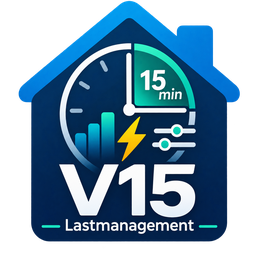

# V15 Lastmanagement für Home Assistant

**Beta-Testversion 0.3.5b4. Keine zertifizierte Begrenzung abrechnungsrelevanter Lastspitzen.**

V15 beobachtet den Netzbezug in festen Viertelstunden (00/15/30/45), schätzt die voraussichtliche Viertelstundenleistung und kann bei drohender Überschreitung ausgewählte **unkritische** Home-Assistant-Schalter abschalten. Ab Beta 3 ist eine **optionale automatische Wiedereinschaltung** möglich.

## Funktionen

- Frei wählbarer Leistungssensor (W/kW), Vorzeichenumkehr und maximale Messwertalterung.
- 15-Minuten-Durchschnitt, Prognose, Verbrauch, Messabdeckung und konservatives Restbudget.
- Individuell konfigurierbare Leistungsgrenze und Reserve.
- Priorisierte Abschaltung mehrerer `switch`-Entitäten.
- **Neu:** Wiedereinschalten in umgekehrter Abschaltreihenfolge, wenn die Reserve nachweisbar ausreicht.
- Simulation mit echten Messwerten ohne Schaltung und Demo mit künstlichen Messwerten.
- Diagnose mit verwalteten Abschaltungen, Rückschaltkandidat und Wartegrund.
- 14 Entitäten (7 reguläre Messsensoren einschließlich Diagnose + 1 neuer Abschaltungszähler, 3 Binärsensoren, 3 Steuerschalter). Die bestehenden `unique_id`s bleiben unverändert.

## Installation und Update über HACS

1. Das Repository `https://github.com/SchreiterC/ha-v15-lastmanagement` als benutzerdefiniertes Repository vom Typ **Integration** hinzufügen, falls noch nicht vorhanden.
2. V15 Lastmanagement in HACS herunterladen oder auf die neue Version aktualisieren.
3. Home Assistant vollständig neu starten.
4. Bei Neuinstallation V15 unter **Einstellungen → Geräte & Dienste** einrichten. Bestehende Installationen **nicht löschen**. Die 13 bisherigen Entitäten behalten ihre Identität, zusätzlich erscheint „V15 Verwaltete Abschaltungen“.
5. Bei einem Upgrade von Beta 2: **V15 → Konfigurieren/Optionen** öffnen, um die neuen Wiedereinschaltoptionen zu setzen. Standardmäßig bleibt die Wiedereinschaltung deaktiviert.

## Sprache und Erklärung im Einrichtungsdialog

Die Einstellungsseiten sind auf **Deutsch und Englisch** übersetzt. Die Sprache richtet sich nach der eingestellten Sprache des Home-Assistant-Benutzers. Alle Felder enthalten nun zusätzliche Erläuterungen. Auf der zweiten Seite erklärt V15 die benötigten Leistungswerte in **Watt**, zeigt die ausgewählten Schalter und warnt vor zu kleinen Schätzwerten.

Nach einem manuellen Austausch der Integrationsdateien ist ein **vollständiger Home-Assistant-Neustart** erforderlich. Bei nicht aktualisierten Texten die Seite neu laden (gegebenenfalls Browser-Cache aktualisieren). Bei einem Upgrade über HACS dieselben Schritte nach dem Download ausführen.

## Konfiguration der Wiedereinschaltung

Unter **Einstellungen → Geräte & Dienste → V15 Lastmanagement → Konfigurieren**:

1. Wie bisher Netzsensor, 15-Minuten-Grenze, Reserve und Abschalt-Schalter wählen.
2. **Automatische Wiedereinschaltung erlauben** aktivieren. Ohne diese ausdrückliche Freigabe werden Lasten weiterhin nur abgeschaltet.
3. Mindest-Ausschaltdauer (Standard **180 s**), notwendige stabile Reserve (Standard **90 s**) und zusätzlichen Puffer (Standard **200 W**) wählen.
4. Im nächsten Dialog **für jeden konfigurierten Schalter die konservativ erwartete Leistungsaufnahme in Watt** eintragen. Berücksichtige Anlaufspitzen und die reale Wirkung auf den Netzbezug. Bei zu niedriger Schätzung sind Überschreitungen möglich.
5. Die **V15 Aktive Lastabschaltung** bleibt auch bei aktivierter automatischer Wiedereinschaltung nach jedem HA-Neustart ausgeschaltet. Für echte Schaltvorgänge muss sie gezielt eingeschaltet werden.

Beispiel: Bei 5,0 kW Grenzwert und 0,5 kW Reserve liegt das angezeigte Steuerungsbudget höchstens bei 4,5 kW. Ein Gerät mit eingetragener Leistung von 600 W und 200 W zusätzlichem Puffer darf nur eingeschaltet werden, wenn der aktuelle Netzbezug **und** die verbleibende Viertelstundenenergie genügend Platz für insgesamt weitere 800 W lassen. Der Puffer ist eine zusätzliche Vorsichtsmaßnahme und keine Garantie.

### Wie V15 wieder einschaltet

- Es kommen **ausschließlich Schalter infrage, die V15 in diesem Lauf selbst ausgeschaltet hat und deren OFF-Zustand bestätigt wurde**. Bereits zuvor manuell abgeschaltete Geräte werden nicht eingeschaltet.
- Bei manueller bzw. externer Einschaltung endet die Zuständigkeit von V15 für dieses Gerät.
- Der Netzleistungssensor muss gültig sein. Mindestens 60 Sekunden und 95 % Messabdeckung der laufenden Viertelstunde sind erforderlich. Demo und Probelauf schalten nie.
- Die aktuelle Leistung **plus** eingetragene Geräteleistung **plus** zusätzlichen Puffer muss unter dem konservativ begrenzten Restbudget liegen. Eine gefährdete Viertelstundenprognose blockiert die Wiedereinschaltung.
- Die Reserve muss mindestens 90 Sekunden **durchgehend** ausreichend sein, das Gerät mindestens 180 Sekunden ausgeschaltet (beide Zeiten konfigurierbar).
- In den letzten 90 Sekunden einer Viertelstunde startet V15 keine Rückschaltung, damit die neue Viertelstunde nicht mit einer unkontrolliert frisch zugeschalteten Last beginnt.
- Die Rückschaltung erfolgt einzeln, in **umgekehrter Abschaltreihenfolge**. Nach jeder Rückschaltung wird mindestens 60 Sekunden gewartet, bevor ein weiteres Gerät eingeschaltet werden darf.
- Der Status wird als Text in den Attributen von **V15 Diagnose** angezeigt. Der Sensor **V15 Verwaltete Abschaltungen** zählt die von V15 verwalteten ausgeschalteten Schalter.

**Wichtige Einschränkung bei Neustart, Update und Konfigurationsänderung:** V15 vergisst die in diesem Lauf selbst abgeschalteten Verbraucher bewusst beim Neuladen der Integration und lässt sie ausgeschaltet. Sie werden nicht nachträglich automatisch eingeschaltet. Das verhindert eine unkontrollierte Wiedereinschaltung nach Neustarts. Prüfe sie dann manuell. Auch das Deaktivieren der aktiven Laststeuerung schaltet bereits ausgeschaltete Geräte **nicht** sofort wieder ein.

## Sicherheit und Grenzen

- **Keine sicherheitskritischen Lasten** schalten (medizinische Geräte, Gefrierschränke mit Risiko des Warenverlusts, Server, Alarmtechnik, Heizungsschutz etc.).
- Die Einschaltentscheidung verwendet **eine geschätzte Leistungsaufnahme pro Schalter**. Ein `switch` liefert nicht zuverlässig die tatsächliche Leistung oder Einschaltspitze. Selbst bei korrekten Schätzungen können PV, Speicher oder andere Lasten unerwartet reagieren.
- Das aktuelle elektrische Restbudget ist ein konservativ gekappter Wert. Die V15-Berechnung ist kein geeichter Viertelstunden-Zähler; keine Garantie für die Einhaltung eines Netzbetreiber-Limits.
- Die Messintegration berücksichtigt nur positiven Netzbezug; Einspeisung wird nicht gegengerechnet.
- Netzlast, Gerätereaktion und Schaltzustände können zeitlich verzögert sein. Nicht bestätigte Schaltvorgänge werden protokolliert, und Wiedereinschaltbefehle werden nicht unbegrenzt wiederholt.
- Bei fehlenden oder veralteten Netzleistungsdaten werden **weder Abschaltung noch Wiedereinschaltung** ausgelöst. Bereits ausgeschaltete Geräte bleiben vorerst aus.
- Gleichzeitige andere Automationen für dieselben Schalter sind zu vermeiden. V15 steuert keine EV-Ladestromstufen oder Victron-Speicherparameter.

## Sichere Testreihenfolge

1. Backup erstellen, nur eine unkritische Teststeckdose konfigurieren, mit Probelauf starten.
2. Aktive Lastabschaltung einschalten und bei absichtlich niedrigem Grenzwert die bestätigte Abschaltung beobachten.
3. Zum Test der Wiedereinschaltung **nicht zwischendurch die V15-Einstellungen ändern**, da das die Integration neu lädt und die Liste abgeschalteter Geräte löscht.
4. Die übrige Hauslast außerhalb von V15 senken, bis die Reserve für *Geräteleistung + Puffer* ausreicht. Nach Mindest-Ausschaltdauer und stabiler Reserve muss der Schalter einmalig zurückgeschaltet werden.
5. Danach aktive Lastabschaltung deaktivieren und Grenzwerte wieder auf normale Werte stellen.
6. Testfälle mit ungültigen Messwerten und Neustart separat durchführen. Der Code wurde mit Unit-Tests geprüft, der neue Wiedereinschaltpfad ist **noch nicht in einer laufenden Home-Assistant-Installation bestätigt**.

## Fehler und Vorschläge

Bitte ein [GitHub Issue](https://github.com/SchreiterC/ha-v15-lastmanagement/issues) eröffnen und Home-Assistant-Version, V15-Version sowie Diagnose/Protokoll (ohne persönliche Daten und Zugangsdaten) ergänzen.

## Lizenz

MIT für den Quellcode. Das Logo ist eine projektbezogene Grafik.
