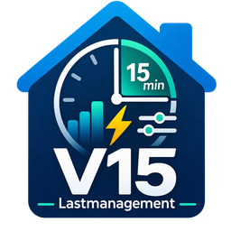

# V15 Lastmanagement für Home Assistant

[**Deutsch**](#deutsch) · [**English**](#english)



> **Version 0.3.8** · Die Kernfunktion zur Viertelstunden-Laststeuerung bleibt unverändert. PV-Start, evcc/Home Connect und die österreichische Netzentgelt-Vorschau sind optional; experimentelle Funktionen bieten keine garantierte Lastspitzenbegrenzung.

---


## Deutsch

### Überblick

**V15 Lastmanagement 0.3.8** ist eine Home-Assistant-Integration zur Überwachung und vorsichtigen Begrenzung von Netzbezugs-Leistungsspitzen innerhalb fester Viertelstunden (00/15/30/45 Minuten). Aus dem gemessenen Netzbezug ermittelt V15 die bisherige Viertelstundenenergie, die Prognose und ein konservatives Leistungsbudget. Bei drohender Überschreitung können ausdrücklich ausgewählte, **unkritische** Verbraucher abgeschaltet werden.

Die Lastabschaltung, ihre optionale Rückschaltung und die Diagnose bilden die Kernfunktion. **Experimentell und nur nach ausdrücklicher Aktivierung** sind die evcc-Steuerung, die Home-Connect-Pause/Fortsetzung und der PV-optimierte Geschirrspülerstart. Die österreichische Netzentgelt-Anzeige ist ein **unverbindliches Informationsmodell**, kein Abrechnungsdienst.

**V15 ist kein geeichter Leistungszähler und garantiert keine Einhaltung abrechnungsrelevanter Lastgrenzen.** Cloud-Befehle, Messwertlatenzen und unbekannte spätere Geräteleistungen lassen keine garantierte Echtzeitbegrenzung zu.

### Funktionen

- Frei wählbarer Netzleistungssensor in W oder kW, optional mit Vorzeichenumkehr und begrenztem Messwertalter.
- Aktuelle Viertelstunden-Netzenergie, Durchschnitt, Prognose, Messabdeckung und verbleibendes Leistungsbudget.
- Konfigurierbare Leistungsgrenze und zusätzliche Sicherheitsreserve.
- Priorisierte Abschaltung mehrerer `switch`-Entitäten.
- Optionale Wiedereinschaltung **nur** der in der aktuellen Laufzeit von V15 bestätigten Abschaltungen.
- Probelauf mit echten Messwerten ohne Schaltbefehle sowie Demonstrationsmodus mit künstlichen Daten.
- Diagnosewerte für Schaltvorgänge, verwaltete Lasten, Rückschaltkandidaten und Wartegründe.
- Optionale, eigenständig freizugebende evcc-Ladestromsteuerung und Home-Connect-Pause/Fortsetzung.
- Optionaler PV-optimierter Home-Connect-Geschirrspülerstart mit einmaliger Freigabe.
- Optionale Wiederherstellung der beiden V15-Live-Schalter nach einem Neustart.
- Optionale, rein informative Anzeige österreichischer Netz-Leistungsentgelte für Netzebene 7.

### Installation und Aktualisierung

**Voraussetzung: Home Assistant 2026.11 oder neuer.** Die reguläre Version ist **0.3.8**; für dieses Release ist keine Pre-release-Option nötig.

<!-- ha-marketplace:exclude-start -->
[](https://my.home-assistant.io/redirect/marketplace_repository/?owner=SchreiterC&repository=ha-v15-lastmanagement&category=integration)

1. [V15 Lastmanagement im Home Assistant Marketplace öffnen](https://my.home-assistant.io/redirect/marketplace_repository/?owner=SchreiterC&repository=ha-v15-lastmanagement&category=integration). Falls V15 im Katalog nicht zu finden ist, unter **Einstellungen → Marketplace → Add from link** die Adresse `https://github.com/SchreiterC/ha-v15-lastmanagement` hinzufügen. Für benutzerdefinierte Repositories kann eine GitHub-Verbindung erforderlich sein.
2. Im Marketplace die **reguläre Version 0.3.8** installieren beziehungsweise die vorhandene Installation auf diese Version aktualisieren.
3. **Home Assistant vollständig neu starten.**
4. Bei Neuinstallation unter **Einstellungen → Geräte & Dienste** V15 einrichten. Bei Updates die vorhandene Integration **nicht löschen**; die bisherigen Konfigurationen und Entitätskennungen sollen erhalten bleiben.
5. Neue optionale Funktionen unter **V15 Lastmanagement → Konfigurieren** bewusst aktivieren. Nach dem Update die vorhandenen Einstellungen und die Diagnosesensoren prüfen.

Ältere, bereits über HACS installierte Integrationen werden beim Wechsel zum integrierten Marketplace übernommen. Nach einem manuellen Dateiaustausch ebenfalls Home Assistant neu starten. Falls Übersetzungen veraltet erscheinen, die Browserseite vollständig neu laden.
<!-- ha-marketplace:exclude-end -->

### Lastabschaltung und automatische Wiedereinschaltung

Unter **Einstellungen → Geräte & Dienste → V15 Lastmanagement → Konfigurieren** werden Netzsensor, Viertelstunden-Grenze, Reserve und die priorisierten Schalter ausgewählt. Die **aktive Lastabschaltung** ist ein eigener Schalter. Demo und Probelauf führen keine realen Schaltungen aus.

Die **automatische Wiedereinschaltung** ist optional und muss ausdrücklich freigegeben werden. Die Vorgaben sind konfigurierbar:

1. **Mindest-Ausschaltdauer**: standardmäßig **180 Sekunden**.
2. **Stabile Leistungsreserve**: standardmäßig **90 Sekunden**.
3. **Zusätzlicher Leistungspuffer**: standardmäßig **200 W**.
4. **Geschätzte Geräteleistung**: für jeden ausgewählten Schalter separat und konservativ in **Watt** eingeben, einschließlich möglicher Anlaufspitzen.

V15 berücksichtigt nur Geräte, die es **selbst in der aktuellen Laufzeit abgeschaltet** hat und deren Zustand `off` bestätigt wurde. Manuell abgeschaltete Verbraucher werden nicht durch V15 eingeschaltet. Die Rückschaltung erfolgt einzeln und in **umgekehrter Abschaltreihenfolge**. Zwischen zwei Einschaltungen liegen mindestens 60 Sekunden.

Voraussetzung sind gültige Leistungsmesswerte, mindestens **60 Sekunden Messzeit und 95 % Messabdeckung** innerhalb der laufenden Viertelstunde, eine ungefährdete Prognose, ausreichendes Leistungsbudget, die Mindest-Ausschaltdauer und eine stabile Leistungsreserve. In den **letzten 90 Sekunden** einer Viertelstunde wird keine Rückschaltung begonnen. Fehler, fehlende Daten oder nicht bestätigte Zustände blockieren weitere Aktionen.

**Beispiel:** Bei 5,0 kW Grenzwert und 0,5 kW Reserve beträgt das Steuerungsbudget höchstens 4,5 kW. Für einen Verbraucher mit geschätzten 600 W und 200 W Puffer muss zusätzlich eine Reserve für **800 W** vorhanden sein. Das ist eine Vorsichtsregel, keine Garantie für die tatsächliche Verbrauchsspitze.

Nach einem Neustart, einem Neuladen oder einer Änderung der Konfiguration wird die Zuständigkeit für zuvor abgeschaltete Geräte **nicht wiederhergestellt**. Diese Verbraucher bleiben gegebenenfalls ausgeschaltet und müssen manuell überprüft werden. Auch das Deaktivieren der Laststeuerung schaltet sie nicht sofort wieder ein.

### V15-Schalter nach Neustart fortsetzen (optional)

Zwei **voneinander unabhängige und standardmäßig deaktivierte** Einstellungen stehen zur Verfügung:

- **Lastabschaltung nach Neustart fortsetzen** (`restore_live_control_on_restart`): War **V15 Aktive Lastabschaltung** zuvor eingeschaltet, wird dieser Schalter nach Neustart beziehungsweise Neuladen wieder aktiviert. Neue Schaltaktionen erfordern weiterhin gültige Messwerte und die üblichen Sicherheitsprüfungen. Zuvor abgeschaltete Geräte werden dadurch **nicht** automatisch wieder eingeschaltet.
- **PV-Startsteuerung nach Neustart fortsetzen** (`restore_pv_start_on_restart`): War **V15 PV-Programmstart** zuvor eingeschaltet, kann der Schalter wieder aktiv werden. **Eine alte Startfreigabe gilt ausdrücklich nicht weiter.** Nach vollständig gestartetem Home Assistant muss der zugehörige `input_boolean` zunächst **AUS** und dann bewusst wieder **EIN** geschaltet werden.

Ist die jeweilige Option ausgeschaltet, bleibt der entsprechende Live-Schalter nach einem Neustart aus. Der vorsichtige Probelauf ist standardmäßig aktiv. Das ausdrückliche Aktivieren eines Live-Schalters beendet den Probelauf. Die separate evcc-Steuerung muss nach Neustarts weiterhin manuell freigegeben werden. Die Wiederherstellung nutzt den Home-Assistant-Zustandsspeicher und setzt einen zuvor gespeicherten Schalterzustand voraus.

### PV-optimierter Home-Connect-Geschirrspülerstart (experimentell)

Die eigenständige, optionale Steuerung verwendet die **bestehende Home-Connect-Integration** von Home Assistant und einen bewusst gesetzten `input_boolean` als **einmalige Startfreigabe**. Sie ist derzeit auf Home-Connect-**Geschirrspüler** beschränkt und ändert das ausgewählte Programm nicht selbst.

Der Prognosesensor muss das Attribut `wh_period_15m` enthalten: ISO-8601-Zeitstempel mit **Wh je 15 Minuten**, zum Beispiel aus Open-Meteo Solar Forecast. V15 vergleicht die Solarerzeugung über die **gesamte geschätzte Programmdauer**. Eine Prognose des tatsächlich verfügbaren PV-Überschusses ist das nicht, weil künftige Haushaltslasten unbekannt sind.

**Einrichtung und Ablauf:**

1. In den V15-Optionen **Experimentellen PV-optimierten Home-Connect-Programmstart** aktivieren. Die Entität **Ausgewähltes Programm** des Geschirrspülers, den Freigabe-Helfer, den Prognosesensor, Startzeitraum, Programmdauer, Mindest-PV-Energie, angenommene Geräteleistung, Puffer und erforderliche stabile Reserve festlegen.
2. Den separaten Schalter **V15 PV-Programmstart** aktivieren. Er ist unabhängig von Lastabschaltung und evcc. Wenn die Neustart-Wiederherstellung nicht eingeschaltet ist, muss er nach Neustarts erneut aktiviert werden.
3. Am Gerät das gewünschte Programm einstellen, die Tür schließen, Fernstart aktivieren und den gewählten Freigabe-Helfer für diesen Spülgang bewusst einschalten.
4. Vor einem Start prüft V15 den Status `ready`, geschlossene beziehungsweise verriegelte Tür, Fernsteuerung, Fernstart, Verbindung, ausgewähltes Geschirrspülprogramm, gültige V15-Messwerte und ausreichendes Viertelstundenbudget.
5. V15 schaltet den Freigabe-Helfer **vor** dem Befehl `home_connect.start_selected_program` aus. Innerhalb von drei Minuten muss der Betriebszustand `run` bestätigt werden. Bei Fehlern oder ausbleibender Bestätigung wird eine Meldung erstellt; ein automatischer zweiter Versuch erfolgt nicht.
6. **Vorherige Home-Assistant-Automationen, die denselben Geschirrspüler starten, deaktivieren**, damit keine konkurrierenden Startbefehle entstehen. Zunächst mit konservativen Leistungsannahmen testen.

Ab dem festgelegten spätesten Startzeitpunkt entfällt für **15 Minuten** nur die PV-Mindestprognose. Alle Geräte- und Leistungsprüfungen bleiben bestehen. Demo, Probelauf, zu geringe Messabdeckung, fehlende oder veraltete Messwerte sowie nicht bestätigte Gerätebereitschaft verhindern den realen Programmstart.

Die Cloud-Reaktionszeit und spätere Heizphasen sind nicht exakt vorauszusehen. Der PV-Start **garantiert keine** Begrenzung der abrechnungsrelevanten Viertelstundenleistung. Ein erfolgreicher Praxistest erfolgte mit einem NEFF-Home-Connect-Geschirrspüler; andere Geräte müssen separat überprüft werden.

### Programmzeiten im Dashboard (experimentell)

Bei konfiguriertem PV-Programmstart stehen drei zusätzliche, rein lesende Sensoren zur Verfügung:

- **V15 PV-Programmstart geplant**: voraussichtlicher Startzeitpunkt.
- **V15 PV-Programmende erwartet**: vor dem Start aus der konfigurierten Programmdauer berechnet, während des laufenden Programms aus dem Home-Connect-Endzeitpunkt übernommen, sofern verfügbar.
- **V15 PV-Programmstatus**: aktueller Status der Startplanung und des Programms.

Optional kann ein Solarprognosesensor für morgen mit dem Attribut `wh_period_15m` ausgewählt werden. Nach Ablauf des spätesten Startzeitpunkts samt 15 Minuten Toleranz wird der nächste Tag für die Vorschau berücksichtigt. Ohne geeignetes PV-Zeitfenster dient der späteste Startzeitpunkt als bedingte Schätzung. Die Prognose setzt weiterhin gültige Freigaben, Startbereitschaft und ausreichendes Lastbudget voraus. Sie erteilt keine Startfreigabe und löst keine zusätzlichen Steuerbefehle aus.

Beispiel für eine manuelle Markdown-Karte im Dashboard (Entitäts-ID bei Bedarf prüfen):

```yaml
type: markdown
show_empty: false
content: |
  
  
    
    **Geschirrspüler: noch {{ minutes // 60 }} Std. {{ minutes % 60 }} Min.**

    Voraussichtlich fertig: {{ as_local(end).strftime('%d.%m., %H:%M') }} Uhr
  
```

### Home Connect pausieren und fortsetzen (experimentell)

Optional können geeignete Home-Connect-Geräte über die vorhandenen `PauseProgram`- und `ResumeProgram`-Entitäten in die Laststeuerung eingebunden werden. **V15 unterbricht dabei nicht die Stromversorgung**, sendet keinen `StopProgram`-Befehl und startet über diese Pause/Fortsetzung-Funktion kein neues Programm.

Eine Pause wird V15 nur zugerechnet, wenn das Gerät den Pausenzustand bestätigt. Ein automatisches Fortsetzen erfolgt ausschließlich für eine von V15 bestätigte Pause, wenn Mindestpause, ausreichendes Leistungsbudget, geschätzte Geräteleistung, Puffer und stabile Reserve erfüllt sind.

Cloudverzögerungen, fehlende Bestätigungen oder Home-Assistant-Neustarts können eine **manuelle Fortsetzung** erforderlich machen. Die automatische Wiedereinschaltung muss für diese Funktion ausdrücklich aktiviert sein. Auch diese Erweiterung ist kein verlässlicher Echtzeit-Lastabwurf.

### Optionale evcc-Ladestromregelung (experimentell)

Die evcc-Funktion verwendet **vorhandene Home-Assistant-Entitäten** einer evcc-Integration, nicht direkt die evcc-HTTP-API. Sie steuert **einen Ladepunkt** pro V15-Eintrag und ist nicht automatisch aktiv.

**Voraussetzungen:** Ein `select` oder `number` für den maximalen Ladestrom in Ampere, ein `select` für den Lademodus (mindestens `smart` und `off`), ein gemessener Wallbox-Leistungssensor in W oder kW sowie die Zahl aktiver Phasen (1 oder 3) beziehungsweise eine bewusst konfigurierte Ersatz-Phasenzahl. Bei einer möglicherweise dreiphasigen Wallbox darf die Ersatz-Phasenzahl nicht fälschlich auf 1 gesetzt werden.

**Konfiguration und Regelung:**

1. Unter **V15 → Konfigurieren** die **optionale evcc-Wallboxsteuerung** einschalten und die Entitäten auswählen. Als Ausgangspunkt für eine typische 3-Phasen-Wallbox dienen etwa **230 V**, **6–16 A**, **300 W** zusätzlicher Puffer, **90 Sekunden** stabile Reserve und **30 Sekunden** Änderungsabstand.
2. **Ladepause zulassen** zunächst deaktiviert lassen. Ohne ausdrückliche Freigabe reduziert V15 höchstens bis zur konfigurierten Mindeststromgrenze, typischerweise 6 A.
3. Den Sensor **V15 evcc Zielstrom** im Probelauf prüfen. Erst danach den gesonderten Schalter **V15 evcc-Ladestromregelung** aktivieren. Geregelt wird nur im Modus `smart`.
4. Stromsenkungen werden ohne die für Erhöhungen geltende Stabilitätswartezeit angefordert. Erhöhungen erfolgen schrittweise um höchstens **1 A** in mindestens **30 Sekunden** Abstand und nie über die zu Steuerungsbeginn vorgefundene Maximalstromgrenze.
5. Falls die minimale Ladeleistung das Budget überschreitet, darf V15 nur bei ausdrücklicher Freigabe und messbarer Ladeleistung den Modus von `smart` auf `off` stellen. Es darf nur eine **eigene** Ladepause später wieder in `smart` freigeben; `now` wird nicht gesetzt.
6. Bei widersprüchlichen Stellbefehlen, ungültigen Messwerten, ungenügender Messabdeckung, fehlender Bestätigung oder externen Änderungen werden weitere Stellbefehle blockiert. Normale V15-Abschaltungen werden bei Gefahr zuerst behandelt.

**Grenzen:** Keine Phasenumschaltung, keine Fahrzeug-SoC-Steuerung, keine Ladepläne, Solarpriorität oder dynamische Tarifoptimierung durch V15. Die Rechnung mit 230 V pro Phase ist eine Näherung. Nach Neustart oder Ausschalten von V15 werden von V15 gesetzte evcc-Grenzen und Ladepausen **nicht automatisch zurückgesetzt**. Die Wallbox daher im evcc-Dashboard überprüfen. Parallele Automationen für denselben Ladestrom oder Modus während des Tests deaktivieren. Der ungeprüfte produktive Einsatz an anderen Hardwarekombinationen wird nicht empfohlen.

### Österreichische Netz-Leistungsentgelte (optionales Informationsmodell)

Version 0.3.8 bietet eine **rein lesende** Kostenanzeige für österreichische Anschlüsse auf **Netzebene 7**. Es werden **14 Netzbereiche** unterschieden: die neun Bundesland-Netzbereiche sowie **Klagenfurt, Linz, Graz, Innsbruck und Kleinwalsertal**. Diese Netzbereiche entsprechen nicht immer exakt den Bundeslandgrenzen.

**Tarifgrundlagen:**

- **Entwurf 2027:** regionale Leistungspreise aus dem **E-Control-Begutachtungsentwurf zur SNE-T-V 2027 vom 29. Oktober 2026**. Diese Daten sind **unverbindlich**, nicht automatisch tatsächlich geltende Tarife und nicht zwingend die späteren Übergangspreise des jeweiligen Netzbereichs. Die Einführungstermine werden nicht automatisch ermittelt.
- **Eigentarif:** Selbst eingegebene monatliche Leistungspreise in **Cent je kW und Monat** für die ersten **10 kW** und für den darüberliegenden Anteil sowie eine einstellbare Mindestverrechnungsleistung. Der voreingestellte Ansatz von **2 kW** gilt nicht ausnahmslos für jeden Vertrag.

**Zusätzliche Sensoren:**

- **V15 Monatsspitze (lokal beobachtet)** in kW: höchster ausreichend vollständig erfasster Viertelstunden-Netzbezug seit Beginn der lokalen Aufzeichnung im laufenden Monat.
- **V15 Leistungsentgelt (Modell, netto)** in EUR pro Monat: rechnerische Leistungskomponente nach ausgewähltem Tarif und lokal beobachteter Monatsspitze.
- **V15 Leistungsentgelt bei Zielspitze (Differenz, Modell)** in EUR pro Monat: **hypothetischer Vergleich** mit der eingestellten V15-Zielspitze, **kein nachgewiesener finanzieller Vorteil**.

Ein Viertelstundenwert wird nur bei mindestens **855 von 900 Sekunden Messabdeckung (95 %)** berücksichtigt. Die erfasste Monatsspitze wird über Home-Assistant-Neustarts gespeichert. Nicht erfasste Zeiträume, Messausfälle, eine Aktivierung mitten im Monat oder frühere historische Spitzen können nicht rekonstruiert werden. Die tatsächliche Netzbetreiber-Abrechnung kann daher **höher** ausfallen.

Die Modellwerte enthalten unter anderem **keine Umsatzsteuer, Energie- und Netzarbeitspreise sowie weitere Netz- und Abgabenbestandteile**. Sie ersetzen weder das Smartmeter-Portal noch die Rechnung des Netzbetreibers. Es erfolgt kein Abruf von Rechnungsdaten und **keine Änderung der V15-Laststeuerung** durch diese Sensoren.

**Quellen:** [E-Control – Begutachtungsentwurf 2027](https://www.e-control.at/de/konsumenten/begutachtungsentwurf-systemnutzungstarife-verordnung-2027) · [SNE-T-V 2027, Entwurf, ` 5 Abs. 1](https://www.wko.at/oe/news/0339-hue-snt-v-2027-begutachtungsentwurf.pdf) · [SNE-G-V, ` 6](https://www.ris.bka.gv.at/eli/bgbl/ii/2026/299/P6/NOR40281083)

### Sichere Testreihenfolge

1. **Backup erstellen** und mit einer unkritischen Teststeckdose beginnen.
2. Im **Probelauf** Netzsensor, Viertelstundenwerte, Budget und Diagnose prüfen.
3. Eine bewusst niedrige Testgrenze einstellen und bei aktiver Lastabschaltung einen bestätigten Abschaltvorgang beobachten.
4. Für die Rückschaltung **die V15-Konfiguration nicht zwischendurch ändern**: Ein Neuladen löscht die Zuständigkeit für zuvor abgeschaltete Lasten. Die Hauslast außerhalb von V15 senken und eine bestätigte, einzelne Rückschaltung nach stabiler Reserve beobachten.
5. Lastgrenze wieder normal einstellen und Testfälle mit fehlenden Messdaten, offenen Türen, deaktiviertem Fernstart, Neustarts und nicht bestätigten Aktionen separat prüfen.
6. Neue Funktionen zunächst nur kontrolliert testen: beim Geschirrspüler die bisherige konkurrierende Automation deaktivieren; bei evcc parallele Regler für dieselben Entitäten deaktivieren; bei der Netzentgelt-Anzeige den gewählten Tarif und die fehlenden historischen Messwerte prüfen.

### Sicherheit und Einschränkungen

- **Keine sicherheitskritischen Verbraucher** abschalten, darunter medizinische Geräte, Server, Alarmtechnik, Heizungs- oder Frostschutz und Gefriergeräte mit relevantem Verlustrisiko.
- Die Wirkung eines Schalters auf den Netzbezug ist geschätzt; Anlaufspitzen, PV, Speicher und andere Haushaltslasten können abweichen.
- Die Berechnung verwendet positiven Netzbezug. Einspeisung wird nicht als frei verfügbares Leistungsbudget gegengerechnet.
- Fehlende, veraltete oder unvollständige Messwerte blockieren Schaltbefehle. Bereits ausgeschaltete Geräte können ausgeschaltet bleiben.
- Verzögerungen in Home Assistant, bei Geräten und insbesondere über Home-Connect-Cloud können eine garantierte Viertelstundenbegrenzung verhindern.
- Konkurrierende Automationen für dieselben Verbraucher oder evcc-Stellgrößen vermeiden. Victron-ESS-Parameter werden in dieser Version nicht unmittelbar gesteuert.
- Die Netzentgelt-Sensoren sind unverbindliche Modellwerte; sie dienen nicht zur rechtsverbindlichen Tarif- oder Einsparungsberechnung.

### Fehler melden und mitarbeiten

Bitte ein [GitHub Issue](https://github.com/SchreiterC/ha-v15-lastmanagement/issues) anlegen und **Home-Assistant-Version**, **V15-Version**, betroffene Entitäten und die relevanten Diagnose- oder Protokollauszüge angeben. Persönliche Daten, Zugangsdaten und andere Geheimnisse vor dem Teilen entfernen.

### Lizenz

Der Quellcode steht unter der **MIT-Lizenz**. Das V15-Logo ist eine projektbezogene Grafik.

---

## English

### Overview

**V15 Lastmanagement 0.3.8** is a Home Assistant integration for monitoring and cautiously limiting grid-import demand peaks within fixed 15-minute intervals (00/15/30/45 minutes). Based on measured grid import, V15 calculates the energy used so far in the current interval, a forecast and a conservative power budget. When the budget is at risk, it can switch off explicitly selected, **non-critical** appliances.

Load shedding, optional load restoration and diagnostics are the core functions. **Experimental and explicitly opt-in** features include evcc control, Home Connect pause/resume and photovoltaic (PV)-optimized dishwasher starting. The Austrian network-charge display is a **nonbinding informational model**, not a billing service.

**V15 is not a certified electricity demand meter and does not guarantee compliance with billable demand limits.** Cloud commands, measurement delays and unknown future appliance loads prevent guaranteed real-time limiting.

### Features

- Configurable grid-power sensor in W or kW, optional sign inversion and maximum reading age.
- Current 15-minute grid-import energy, average, forecast, measurement coverage and remaining power budget.
- Configurable power limit and additional safety margin.
- Priority-based shedding of multiple `switch` entities.
- Optional restoration **only** of loads that V15 has demonstrably shed during the current runtime.
- Dry run using real measurements but no switching, plus demonstration mode with artificial data.
- Diagnostics for control actions, V15-managed loads, restoration candidates and reasons for waiting.
- Optional, independently enabled evcc charging-current control and Home Connect pause/resume.
- Optional PV-optimized Home Connect dishwasher start with one-shot authorization.
- Optional restoration of the two V15 live control switches after restart.
- Optional, informational Austrian grid-capacity charge display for grid level 7.

### Installation and updates

**Requirement: Home Assistant 2026.11 or later.** The regular version is **0.3.8**; it does not require enabling prereleases.

<!-- ha-marketplace:exclude-start -->
[](https://my.home-assistant.io/redirect/marketplace_repository/?owner=SchreiterC&repository=ha-v15-lastmanagement&category=integration)

1. [Open V15 Lastmanagement in the Home Assistant Marketplace](https://my.home-assistant.io/redirect/marketplace_repository/?owner=SchreiterC&repository=ha-v15-lastmanagement&category=integration). If V15 is not listed, use **Settings → Marketplace → Add from link** and add `https://github.com/SchreiterC/ha-v15-lastmanagement`. Custom repositories may require a GitHub connection.
2. Install the **regular version 0.3.8** through the Marketplace, or update an existing installation to this version.
3. **Restart Home Assistant completely.**
4. For a new installation, configure V15 under **Settings → Devices & services**. When upgrading, **do not delete** the existing integration; previous configuration and entity identifiers should be retained.
5. Deliberately enable any new optional features under **V15 Lastmanagement → Configure**. Check previous settings and diagnostic sensors after upgrading.

Older integrations installed using HACS are transferred to the integrated Marketplace when upgrading Home Assistant. After manually replacing integration files, also restart Home Assistant. If translations remain outdated, fully reload the browser page.
<!-- ha-marketplace:exclude-end -->

### Load shedding and automatic load restoration

Under **Settings → Devices & services → V15 Lastmanagement → Configure**, select the grid sensor, quarter-hour demand limit, safety margin and priority-ordered switches. **Active Load Shedding** has its own enable switch. Neither demo mode nor dry run sends real switching commands.

**Automatic load restoration** is optional and requires explicit consent. The parameters are configurable:

1. **Minimum off duration**: **180 seconds** by default.
2. **Stable power headroom**: **90 seconds** by default.
3. **Additional power buffer**: **200 W** by default.
4. **Estimated appliance power**: supply a separate, conservative estimate in **watts** for each selected switch, including possible startup surges.

V15 considers only appliances it **switched off itself during the current runtime** and whose `off` state was confirmed. It never switches on manually disabled loads. Restoration is performed one appliance at a time, in **reverse shedding order**. At least 60 seconds separate consecutive restorations.

Requirements include valid power data, at least **60 seconds of readings and 95% measurement coverage** in the current quarter-hour, a forecast that is not at risk, sufficient power budget, minimum off time and stable headroom. No restoration starts during the **last 90 seconds** of a quarter-hour. Errors, missing data or unconfirmed states block further actions.

**Example:** With a 5.0 kW limit and a 0.5 kW margin, the control budget is at most 4.5 kW. A load estimated at 600 W plus a 200 W buffer requires additional headroom for **800 W**. This is a precaution, not a guarantee of actual demand.

After restart, reload or configuration changes, V15 does **not restore ownership** of previously shed loads. Those appliances may remain off and require manual checking. Disabling live load control does not immediately switch them back on either.

### Resume V15 switches after restart (optional)

Two **independent, OFF-by-default** settings are available:

- **Resume load shedding after restart** (`restore_live_control_on_restart`): If **V15 Active Load Shedding** was previously enabled, the live switch is enabled again after restart or reload. New actions still require valid meter data and the standard safety checks. Previously shed devices are **not** automatically switched back on.
- **Resume PV start control after restart** (`restore_pv_start_on_restart`): If **V15 PV Program Start** was previously enabled, its live switch may be restored. **Previous start authorization is never reused.** After Home Assistant has fully started, the assigned `input_boolean` must first be switched **OFF** and then deliberately **ON** again.

If a corresponding option is disabled, its live switch remains off after restart. Conservative dry-run mode is enabled by default. Explicitly enabling a live switch ends the dry run. The separate evcc controller still requires manual authorization after restarts. Restoration uses Home Assistant's stored entity states and requires a previously saved switch state.

### PV-optimized Home Connect dishwasher start (experimental)

This optional, independent controller uses Home Assistant's **existing Home Connect integration** and a deliberately enabled `input_boolean` as a **one-shot start authorization**. It is currently restricted to Home Connect **dishwashers** and does not change the selected program itself.

The forecast sensor must provide the `wh_period_15m` attribute: ISO-8601 timestamps with **Wh per 15-minute interval**, for example from Open-Meteo Solar Forecast. V15 compares predicted solar energy over the **entire estimated program duration**. This does not predict actual available PV surplus, because future household consumption is unknown.

**Setup and operation:**

1. Enable **Experimental PV-optimized Home Connect Program Start** in the V15 options. Choose the dishwasher's **Selected Program** entity, the authorization helper, forecast sensor, starting window, program duration, minimum PV energy, assumed power draw, safety buffer and required stable headroom.
2. Enable the independent **V15 PV Program Start** switch. It does not depend on load shedding or evcc. Unless restart restoration is configured, re-enable this switch after a restart.
3. Select the desired program on the appliance, close its door, enable remote start and deliberately turn on the chosen authorization helper for that one cycle.
4. Before starting, V15 verifies `ready` state, closed or locked door, remote control, remote start, connectivity, selected dishwasher program, valid V15 readings and adequate 15-minute budget.
5. V15 turns the authorization helper **OFF before** calling `home_connect.start_selected_program`. Within three minutes the appliance must report `run`. Failed or unconfirmed attempts generate a notification; there is no automatic second attempt.
6. **Disable any existing Home Assistant automation that starts the same dishwasher** to prevent competing start commands. Begin testing with conservative power estimates.

For **15 minutes** after the configured latest start time, only the minimum PV forecast requirement is waived. All appliance and budget checks remain mandatory. Demo mode, dry run, insufficient coverage, missing or stale readings and unconfirmed appliance readiness block real starts.

Cloud response times and later heating stages cannot be predicted precisely. PV starting **does not guarantee** compliance with billable quarter-hour demand limits. A real-world test with a NEFF Home Connect dishwasher succeeded; other devices require separate verification.

### Program timing on the dashboard (experimental)

Three additional read-only sensors are available when PV program start is configured: **V15 PV-Programmstart geplant** (estimated start), **V15 PV-Programmende erwartet** (estimated finish), and **V15 PV-Programmstatus** (program status). Before starting, the finish estimate uses the configured program duration. During operation it uses the Home Connect finish timestamp, if available.

An optional tomorrow forecast sensor can be selected with the same `wh_period_15m` attribute. After the latest start time plus a 15-minute grace period, the preview considers tomorrow. If no qualifying PV window exists, the deadline is used as a conditional estimate. All estimates depend on readiness, authorization and adequate load budget; they do not authorize a start or send additional control commands. The dashboard example in the German section also works in English installations; verify the entity ID.

### Home Connect pause and resume (experimental)

Compatible Home Connect appliances can optionally participate in load control through existing `PauseProgram` and `ResumeProgram` entities. **V15 does not disconnect their electricity**, does not send `StopProgram` and does not start a new program through this pause/resume feature.

V15 claims a pause only after the appliance confirms the paused state. Automatic resumption is limited to a V15-confirmed pause, and requires the minimum pause time, sufficient power budget, estimated appliance draw, buffer and stable headroom.

Cloud latency, missing confirmations or Home Assistant restarts may require **manual resumption**. Automatic load restoration must be explicitly enabled for this feature. This extension is also not a reliable real-time load-shedding mechanism.

### Optional evcc charging-current control (experimental)

The evcc feature uses **existing Home Assistant entities** provided by an evcc integration, not the evcc HTTP API directly. It controls **one charging point** per V15 entry and is not enabled automatically.

**Prerequisites:** A `select` or `number` for maximum charging current in amperes; a charging-mode `select` (at least `smart` and `off`); a measured wallbox power sensor in W or kW; and either the number of active phases (1 or 3) or a deliberately chosen fallback phase count. Never incorrectly set a potentially three-phase wallbox's fallback count to 1.

**Configuration and control:**

1. Under **V15 → Configure**, enable **Optional evcc Wallbox Control** and choose the entities. A typical starting configuration for a three-phase wallbox is approximately **230 V**, **6–16 A**, **300 W** extra buffer, **90 seconds** stable headroom and a **30-second** change interval.
2. Leave **Allow charging pause** disabled initially. Without explicit consent, V15 only reduces to the configured minimum current, typically 6 A.
3. Check the **V15 evcc Target Current** sensor in dry run before enabling the separate **V15 evcc Charging Current Control** switch. Control is issued only in `smart` mode.
4. Current decreases are requested without the stability delay required for increases. Increases occur in steps of at most **1 A** at intervals of at least **30 seconds**, never exceeding the maximum current present when V15 control started.
5. If minimum charging power exceeds the budget, V15 may switch the mode from `smart` to `off` only with explicit permission and measurable charging power. It may resume only a charging pause **it created itself**, back to `smart`; it never selects `now`.
6. Conflicting commands, invalid readings, insufficient coverage, missing confirmations or external changes block further control commands. Standard V15 load shedding takes priority when the budget is at risk.

**Limitations:** V15 does not switch phases, manage vehicle state of charge, charging schedules, solar priority or dynamic electricity prices. The calculation using 230 V per phase is approximate. After restarts or disabling V15, evcc limits and charging pauses previously set by V15 are **not automatically reset**. Check the wallbox in the evcc dashboard. Disable concurrent automations controlling the same current or mode during testing. Unverified production use with different hardware combinations is not recommended.

### Austrian grid-capacity charges (optional informational model)

Version 0.3.8 provides **read-only** cost estimates for Austrian connections at **grid level 7**. It distinguishes **14 network areas**: the nine federal-state areas plus **Klagenfurt, Linz, Graz, Innsbruck and Kleinwalsertal**. These network areas do not necessarily follow federal-state borders exactly.

**Tariff sources:**

- **2027 draft:** regional capacity rates from the **E-Control consultation draft for SNE-T-V 2027 dated 29 October 2026**. These rates are **nonbinding**, not necessarily currently effective and not necessarily the later transitional tariffs for each area. V15 does not automatically determine their start dates.
- **Own tariff:** manually entered monthly capacity rates in **cents per kW per month** for the first **10 kW** and demand above that threshold, plus a configurable minimum billed demand. The default **2 kW** minimum does not apply to every contract without exception.

**Additional sensors:**

- **V15 Monthly Peak (locally observed)** in kW: highest sufficiently covered quarter-hour grid-import demand observed since local monitoring started in the current month.
- **V15 Capacity Charge (model, net)** in EUR per month: calculated monthly capacity component using the chosen tariff and the locally observed peak.
- **V15 Capacity Charge at Target Peak (difference, model)** in EUR per month: a **hypothetical comparison** with the configured V15 target peak, **not demonstrated financial savings**.

A 15-minute interval is counted only if at least **855 out of 900 seconds (95%)** are covered. The locally observed monthly peak is preserved across Home Assistant restarts. Unobserved periods, meter failures, activation in the middle of a month and earlier historical peaks cannot be reconstructed. The network operator's actual bill may therefore be **higher**.

The model excludes, among other items, **VAT, energy and network usage-based charges and other network or tax components**. It replaces neither the smart-meter portal nor the network operator's invoice. No billing data is retrieved, and these sensors **do not modify V15 load control**.

**Sources:** [E-Control – 2027 consultation draft](https://www.e-control.at/de/konsumenten/begutachtungsentwurf-systemnutzungstarife-verordnung-2027) · [SNE-T-V 2027 draft, ` 5(1)](https://www.wko.at/oe/news/0339-hue-snt-v-2027-begutachtungsentwurf.pdf) · [SNE-G-V, ` 6](https://www.ris.bka.gv.at/eli/bgbl/ii/2026/299/P6/NOR40281083)

### Safe test procedure

1. **Create a backup** and begin with one non-critical test socket.
2. Use **dry-run mode** to check the grid sensor, quarter-hour readings, power budget and diagnostics.
3. Temporarily set a deliberately low demand limit, enable live shedding and observe a confirmed switch-off.
4. For restoration, **do not change V15 configuration mid-test**: a reload clears ownership of previously shed loads. Reduce other household loads and observe one confirmed restoration after stable headroom.
5. Restore normal limits and separately test missing meter data, open doors, disabled remote start, restarts and unconfirmed actions.
6. Test optional features under supervision: disable the old competing dishwasher automation, disable parallel evcc regulators for the same entities, and verify selected tariff data and historical-data gaps in the cost display.

### Safety and limitations

- **Never shed safety-critical appliances**, including medical equipment, servers, alarms, heating or freeze protection and freezers where loss would be significant.
- The impact of switching a load on grid demand is estimated; startup peaks, PV, batteries and other household loads may behave differently.
- The calculation uses positive grid import. Exported power is not treated as available extra capacity.
- Missing, stale or insufficient readings block commands. Previously switched-off devices may remain off.
- Delays in Home Assistant, physical devices and particularly Home Connect cloud services prevent guaranteed quarter-hour peak limiting.
- Avoid competing automations for the same appliances or evcc controls. This version does not directly control Victron ESS parameters.
- Austrian capacity-charge sensors are nonbinding estimates, not legally definitive tariff or savings calculations.

### Report problems and contribute

Please open a [GitHub Issue](https://github.com/SchreiterC/ha-v15-lastmanagement/issues) and include your **Home Assistant version**, **V15 version**, relevant entities and diagnostic or log excerpts. Remove personal information, credentials and other secrets before sharing.

### License

The source code is licensed under the **MIT License**. The V15 logo is project-specific artwork.
